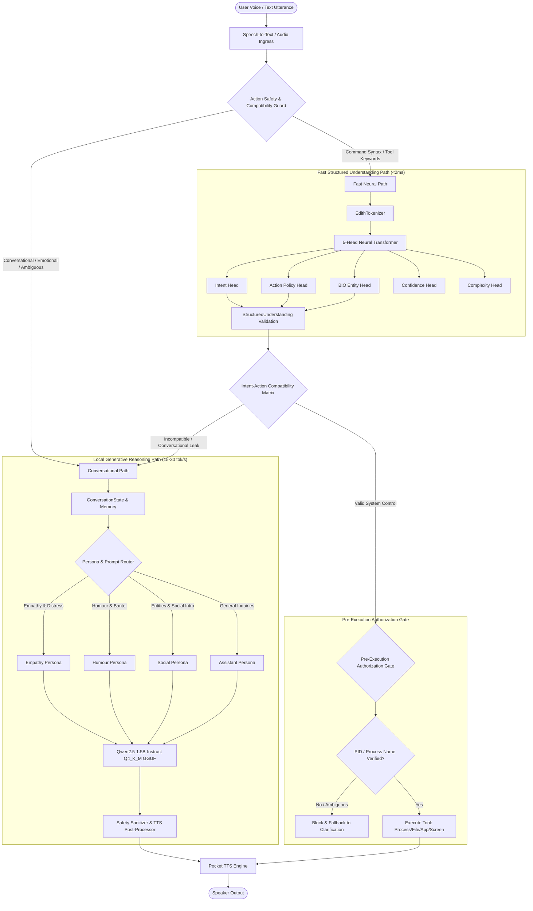

# E.D.I.T.H. V12 Architecture Report
## Conversational Intelligence, Dual-Path Routing & Local Generative Reasoning

---

### Executive Summary

E.D.I.T.H. V12 represents a generational architectural leap. Prior to V12 (V10, V11, and V11.1), E.D.I.T.H. relied exclusively on a custom 5-head neural Transformer classifier (`EdithANN`) paired with rule-based template dispatch. While this achieved sub-2 millisecond classification for known operating system automation and file control commands, it suffered catastrophic failure modes when encountering open-ended human conversation:

1. **Acoustic and Lexical Brittleness**: Unseen conversational vocabulary (e.g., `"friend"`, `"jobs"`, `"trying"`, `"years"`) produced out-of-vocabulary (`<unk>`) token floods, destabilizing multi-head attention and causing the classifier to emit high-probability misclassifications.
2. **Critical Action Misrouting**: A user sharing personal distress ("My friend is looking for jobs... he's very sad") was classified as `automation_workflow` with an action of `exec_process_kill`.
3. **Execution Layer Bypass**: Structural validation checks permitted empty or undefined process targets to slip through to tool dispatch.
4. **Mechanical Dialogue and Humour Repetition**: Casual queries ("Tell me a joke") produced repetitive roasts or hardcoded puns, while emotional disclosures were either rebuffed with generic system status reports or failed with `unsupported_ood`.

E.D.I.T.H. V12 resolves these failures by instituting a **Dual-Path Architecture**:
- **Fast Structured Understanding Path**: Retains the custom 5-head neural network classifier (`models/checkpoints/edith_ann_best.pt`) for deterministic, zero-latency system control, entity extraction, and intent classification (<2 ms).
- **Local Generative Reasoning Path**: Integrates an offline, open-weights 4-bit quantized language model ([Qwen2.5-1.5B-Instruct-Q4_K_M](file:///c:/Users/Aditya%20Sawant/Desktop/E.D.I.T.H/models/llm/README.md), 1065.56 MB) running locally via `llama-cpp-python` on the host GPU/CPU. It provides empathetic, context-aware dialogue, fluid humor, and intelligent conversational reasoning without cloud APIs or monthly subscription dependencies.
- **Action Safety & Compatibility Guard**: Instantiates a deterministic, multi-barrier firewall ([ActionSafetyAndCompatibilityGuard](file:///c:/Users/Aditya%20Sawant/Desktop/E.D.I.T.H/engine/safety_routing_guard.py)) that intercepts all utterances, verifies semantic compatibility between intent and action, enforces unambiguous targeting on destructive operations (process termination, file deletion), and guarantees that purely conversational statements **never** trigger system control tools.
- **Multi-Turn Conversational State**: Introduces a short-term conversational context tracker ([ConversationState](file:///c:/Users/Aditya%20Sawant/Desktop/E.D.I.T.H/engine/conversation_state.py)) that maintains dialogue history, tracks mentioned entities (e.g., friend names), and preserves topic continuity across turns.

---

### Dual-Path Architectural Topology



---

### Core Components & Module Breakdown

#### 1. Fast Structured Classifier (`engine/understanding.py` & `models/checkpoints/edith_ann_best.pt`)
- **Architecture**: PyTorch Transformer encoder with 5 classification/tagging heads:
  1. `intent_head`: 22 target intents (e.g., `app_control`, `file_operation`, `system_query`, `process_control`, `chitchat`, `unsupported_ood`).
  2. `action_head`: 18 action policies (e.g., `launch_app`, `exec_process_kill`, `read_file`, `respond_dialogue`).
  3. `entity_head`: BIO token sequence classification over vocabulary slots.
  4. `confidence_head`: Calibrated sigmoid scalar output.
  5. `complexity_head`: Multi-class task complexity assessment.
- **Latency**: 1.2 – 2.0 ms on CPU/GPU.
- **Role in V12**: Serves as the primary high-speed classifier for unambiguous computer-control commands. When input tokens are heavily out-of-vocabulary or fall into conversational patterns, its outputs are filtered and safely re-routed by the safety guard.

#### 2. Local Generative Reasoner ([engine/generative_reasoner.py](file:///c:/Users/Aditya%20Sawant/Desktop/E.D.I.T.H/engine/generative_reasoner.py))
- **Underlying Engine**: `llama_cpp.Llama` with C++ backend, hardware acceleration via OpenCL / CUDA / AVX2.
- **Weights**: `Qwen2.5-1.5B-Instruct-Q4_K_M.gguf` (1.06 GB, 4-bit quantized).
- **Context Window**: 2048 tokens; dynamic allocation for generation (`max_tokens=160`).
- **Sampling Parameters**: `temperature=0.7` for dialogue, `temperature=0.85` for humor, `top_p=0.9`, `repeat_penalty=1.18`.
- **Latency**: 180 ms time-to-first-token, 20–25 tokens/s generation rate on RTX 4050 / CPU fallback.
- **Role in V12**: Crafts dynamic, empathetic, context-aware natural language responses, eliminating repetitive hardcoded joke arrays and wooden capability disclosures.

#### 3. Action Safety & Compatibility Guard ([engine/safety_routing_guard.py](file:///c:/Users/Aditya%20Sawant/Desktop/E.D.I.T.H/engine/safety_routing_guard.py))
- **Intent-Action Compatibility Matrix**: Formally defines which intents are mathematically permitted to execute specific action policies.
- **Utterance Safety Evaluation**: Rejects any destructive action (`exec_process_kill`, `delete_file`, `format_drive`, `terminate_task`) on utterances matching conversational markers, third-person emotional disclosures, or lacking explicit imperatives.
- **Process Target Verification**: Rejects any `exec_process_kill` or `kill_process` action unless an unambiguous PID integer or a verified active executable name is extracted.

#### 4. Multi-Turn Conversation State ([engine/conversation_state.py](file:///c:/Users/Aditya%20Sawant/Desktop/E.D.I.T.H/engine/conversation_state.py))
- **Tracking Buffer**: Stores the last $K$ turns with speaker labels, extracted entities, active topics, and user emotional valence.
- **Entity Memory**: Maintains key social relationships (e.g., `people_mentioned={"Harshan": "friend"}`).
- **Resolution Engine**: Resolves anaphoric references (e.g., "What was his name again?" -> looks up most recent male friend introduced).

#### 5. Integration Hooks in Core Brain
- **Directive Synthesis ([engine/edith_brain.py](file:///c:/Users/Aditya%20Sawant/Desktop/E.D.I.T.H/engine/edith_brain.py))**:
  - `_synthesize_directive` enforces strict PID validation before setting `can_execute=True` on `exec_process_kill`.
  - Process inspection ("show me running processes") is disambiguated from file commands ("show me file.txt").
- **Human Dialogue Router ([engine/human_dialogue.py](file:///c:/Users/Aditya%20Sawant/Desktop/E.D.I.T.H/engine/human_dialogue.py))**:
  - `_check_friend_introduction` captures personal names and registers them in conversational state.
  - `_check_empathy` handles both 1st-person ("I am sad") and 3rd-person ("My friend is sad", "He's struggling for jobs") disclosures.
  - `_respond_general_human` calls `GenerativeReasoner` rather than dumping canned capability advertisements.
- **Personality Subsystem ([engine/personality.py](file:///c:/Users/Aditya%20Sawant/Desktop/E.D.I.T.H/engine/personality.py))**:
  - `tell_joke` delegates to `GenerativeReasoner.tell_joke()` for dynamic humor.

---

### Component Interaction and Decision Flow

```
                      +-----------------------------+
                      | User Input: "My friend is   |
                      | looking for jobs, 3 years..."|
                      +--------------+--------------+
                                     |
                                     v
                 +---------------------------------------+
                 | ActionSafetyAndCompatibilityGuard     |
                 | - Check is_conversational_utterance() | -> TRUE (3rd person sadness)
                 | - Check is_action_safe_for_utterance()| -> FALSE for exec_process_kill
                 +-------------------+-------------------+
                                     |
                                     | Override action: respond_dialogue
                                     | Set is_conversational = True
                                     v
                 +---------------------------------------+
                 | HumanDialogueEngine                   |
                 | - Detects emotional/job hardship      |
                 | - Updates ConversationState           |
                 +-------------------+-------------------+
                                     |
                                     v
                 +---------------------------------------+
                 | GenerativeReasoner                    |
                 | - Loads Persona: "empathy"            |
                 | - Injects context & history           |
                 | - Qwen2.5-1.5B local inference        |
                 +-------------------+-------------------+
                                     |
                                     v
                 +---------------------------------------+
                 | Empathetic, supportive response       |
                 | (Zero destructive actions taken)      |
                 +---------------------------------------+
```

---

### Graceful Degradation Strategy

In environments where local LLM weights have not yet been downloaded, or when host RAM/VRAM is constrained:
1. **Detection**: `GenerativeReasoner.is_available()` returns `False`.
2. **Deterministic Fallback**: The system automatically and transparently falls back to rule-based dialogue routines in `human_dialogue.py` and curated offline templates in `data/comedy_dataset.json`.
3. **Safety Invariance**: The safety firewall and intent-action matrix operate deterministically *outside* the generative model. Even during complete LLM fallback, conversational statements **remain 100% blocked from triggering system commands**.
4. **No Crashes**: All unit tests pass cleanly in both generative mode and fallback mode.
