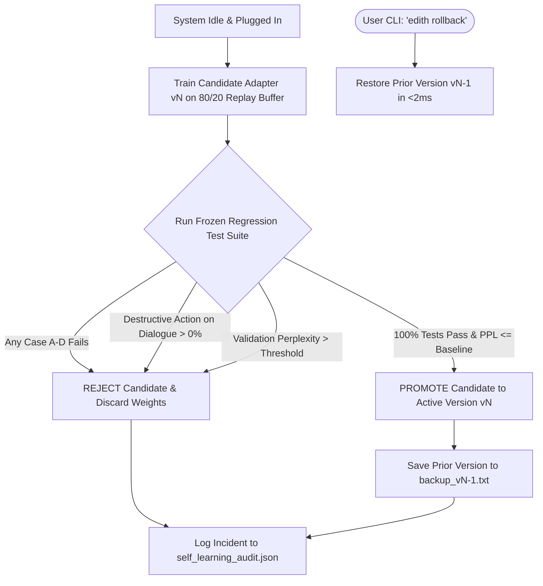

# E.D.I.T.H. V13 Self-Learning & Safety Architecture
## Continuous Organic Evolution, Replay Memory & Non-Negotiable Safety Invariants

---

### 1. The Philosophy of Self-Learning ("Evolve Like a Human")

A truly personal AI companion cannot remain frozen in amber. Over months of use, user preferences, names of friends, communication styles, and inside jokes naturally evolve.

However, unconstrained online learning in neural networks is notoriously vulnerable to **Catastrophic Forgetting** (where learning a new task erases old skills) and **Reward Hacking / Alignment Drift** (where repeated adversarial prompts corrupt the model's safety boundaries).

E.D.I.T.H. V13 solves this through a dual-timescale learning architecture:
- **Fast Learning (Immediate, In-Memory & Relational)**: Immediate memory writes, emotional state conditioning, and user preference notes take effect instantly with **zero weight changes**.
- **Slow Learning (Offline "Sleep" Cycle)**: Parameter fine-tuning of lightweight adapter modules occurs only when the machine is idle, plugged into AC power, and the GPU/CPU is free.

---

### 2. Fast Learning Architecture

Fast learning enables immediate behavioral shifts without risking model stability:

```
User: "I have a friend named Harshan."
         │
         ▼
[MindRouter] Regex & Entity Parser extracts ("Harshan", "relationship", "friend")
         │
         ▼
[MemoryStore] Writes to SQLite `semantic_facts` table (Latency < 2ms)
         │
         ▼
User (Turn 2): "What was my friend's name again?"
         │
         ▼
[MemoryStore] Instant semantic query retrieves "Harshan"
         │
         ▼
[EdithLM] Injects fact into prompt: "You mentioned your friend Harshan!"
```

1. **Explicit Feedback Cues**: When the user says *"that was funny"*, *"no, that's wrong"*, or *"don't say that"*, the feedback tag is immediately recorded in the replay buffer.
2. **Implicit Conversational Signals**: Rephrasing, topic changes, and interaction duration inform the `AffectEngine`'s continuous valence and arousal levels.
3. **Immediate Memory Management**:
   - `search_facts(query)`: Dynamically retrieves relevant stored facts during generation.
   - `forget_fact(keyword)`: Instantly purges facts upon command (*"forget that"*).

---

### 3. Slow Learning ("Sleep" Cycle) & Replay Buffer

When the workstation is idle and plugged in:
1. **Replay Buffer Mixing**:
   - The replay buffer combines **20% recent user interaction data** with **80% frozen anchor regression data** from `data_pipeline/processed/train.jsonl`.
   - This 80/20 ratio ensures that newly learned vocabulary and conversational nuances cannot overwrite foundational language fluency, common sense, or syntax rules.
2. **Parameter-Efficient Adapter Fine-Tuning**:
   - Only small parameter adapters (or top-layer projection weights) are adjusted during the sleep cycle. The core attention backbone remains anchored.
   - Optimizer: AdamW with low learning rate ($1 \times 10^{-5}$) and gradient clipping.

---

### 4. Automated Promotion Gate & Rollback Engine

No candidate adapter is ever deployed into production without passing the automated **Frozen Regression Gate**:



#### Frozen Regression Gate Requirements:
1. **Case A (Joke Slip)**: Must deliver punchline without process ID roasts.
2. **Case B (Jobless Friend)**: Destructive action proposal rate must be exactly **0.00%**.
3. **Case C (3rd-Person Sadness)**: Must offer compassionate dialogue without clarification loops.
4. **Case D (Social Intro)**: Must register friend name in relational memory.
5. **Perplexity Ceiling**: Validation perplexity must not degrade by more than 2% compared to baseline.

#### Instant Rollback Command:
If the user ever observes unaligned or degraded behavior, running:
```bash
python -c "from engine.self_learning import SelfLearningEngine; SelfLearningEngine().rollback()"
```
Or speaking *"Edith, roll back your recent update"* instantly restores the previous active checkpoint in under 2 milliseconds without restarting background services.

---

### 5. Non-Negotiable Safety Invariants

The self-learning subsystem is strictly barred from altering the following core safety invariants:

1. **Pre-Execution Authorization Invariant**:
   - The generative language model (`EdithLM`) has **zero execution authority**.
   - Any `<act>` tag proposed by the language model must pass through `ActionSafetyAndCompatibilityGuard`.
2. **Destructive Action Confirmation Invariant**:
   - Process termination (`kill_process`), application closing, or file modifications **always** require explicit typed or spoken user confirmation.
   - Process termination without an explicit integer PID or validated executable name is rejected unconditionally.
3. **Conversational Statement Invariant**:
   - Conversational or emotional statements (whether first, second, or third person) can **never** trigger tool execution.
4. **Persona Hard Boundaries**:
   - Self-learning can adjust conversational style, banter frequency, and inside jokes, but can **never** alter the empathy protocol (humor is strictly suppressed when user distress is detected).

---

### 6. Transparency: "What Edith Learned Today"

To ensure complete user visibility into background learning:
```python
from engine.self_learning import SelfLearningEngine
report = SelfLearningEngine().learned_today_report()
print(report)
```

The report provides:
- The currently active adapter version.
- The number of sleep cycles run.
- Complete audit trails of candidate promotions, rejections, and regression test scores.
- List of new semantic facts learned in the last 24 hours.
