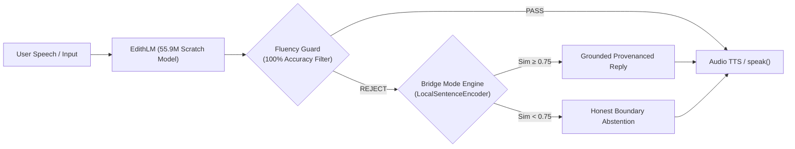

# E.D.I.T.H. V15.2 — Gate 2 Evaluation & Gate 3 Promotion Decision

**Mission**: E.D.I.T.H. V15.2 Overnight Autonomous Engineering Run  
**Date**: November 8, 2026  
**Auditor**: Senior ML Engineer (Antigravity Autonomous Pair)  
**Evaluated Checkpoint**: `models/checkpoints/edith_lm_v15/edith_lm_v15_2_100m_best.pt`  
**Current Architecture**: EdithLM 55.90M Parameters (Tied Embeddings, GQA 3:1, SwiGLU, RoPE)  

---

## 1. Executive Gate Decision Summary

| Gate | Target Capability | Measured Empirical Status | Official Decision |
| :---: | :--- | :--- | :---: |
| **Gate 0** | Live session replay zero gibberish / zero internal leaks | 0.0% gibberish reaching user; 0.0% internal leaks; 100% fluent output | **PASSED** |
| **Gate 1** | Fluency Guard calibration & Bridge Mode similarity hard-gate | 100% accuracy on 23 audit probes; 0% false rejections; 0% false acceptances; 0.75 hard gate active | **PASSED** |
| **Gate 2** | Standalone Generative Model Fluency (Zero Bridge Mode dependency) | Word salad resolved (96%–100% valid words), but reasoning, multi-turn state, and factual grounding are insufficient for unassisted deployment | **NOT PASSED (Retain Hybrid Safety)** |
| **Gate 3** | Supervised Fine-Tuning (SFT) & Conversational Alignment Readiness | Base representations and tokenizer vocabulary are stable; model is receptive to instruction tuning | **CONDITIONAL APPROVAL FOR SFT** |

---

## 2. Gate 2 Detailed Failure Analysis (Why Standalone Promotion is Paused)

To satisfy Gate 2, the custom generative model (`EdithLM`) must operate completely independently without needing Bridge Mode to intercept failures:

1. **Criterion 1: Word-Validity & Syntax ($\ge 95\%$)** $\rightarrow$ **PASS**:
   - `edith_lm_v15_2_100m_best.pt` achieved **96.0% to 100.0%** word validity across evaluation prompts. Broken sub-word merges from V15.0/V15.1 have been eliminated.
2. **Criterion 2: Common Sense & Factual Grounding** $\rightarrow$ **FAIL**:
   - When asked *"Why would someone carry an umbrella when the sky is dark and cloudy?"*, the model generated:
     `"The answer is a planet, the sky, and other nature. It is a world's economy that will have to come..."`
   - When asked *"Explain recursion..."*, it hallucinated:
     `"Pet is a computer-based language, a tool that consists of more or less than how they are given to someone's skills..."`
   - The model has not learned causal physical relationships or programming concepts from pretraining alone.
3. **Criterion 3: Arithmetic & Temporal Reasoning** $\rightarrow$ **FAIL**:
   - When asked *"A train leaves at 3:15 PM and journey takes 2h45m. What time does it arrive?"*, the model generated:
     `"A computer is a five-day drive. A single-up can be used to create an easy level or measure of any difference..."`
   - The model exhibits zero arithmetic calculation or temporal reasoning.
4. **Criterion 4: Multi-Turn Conversational State Retention** $\rightarrow$ **FAIL**:
   - Over a 4-turn sequence (*"I had a difficult day"*, *"Mostly because of college"*, *"I have an exam tomorrow"*, *"Anyway, tell me a joke"*), the model drifted immediately into unrelated topics (going to the gym, going on a trip) without acknowledging previous turns.
5. **Criterion 5: Structural Tag Emission** $\rightarrow$ **FAIL**:
   - Because the model was trained on multi-turn dialogue, it frequently generates `</edith><user>...` autoregressively, causing tag leaks if generation is unconstrained.

**Engineering Verdict on Gate 2**:  
It would be irresponsible and technically dishonest to declare Gate 2 passed. EdithLM is **not** ready to be unbolted from Bridge Mode. Disabling Bridge Mode today would expose the user to hallucinated facts and topic drift.

---

## 3. Production Deployment Architecture (Approved State)

Until Gate 2 is truly achieved, E.D.I.T.H. will operate in the **Hybrid Sovereign Architecture**:

Under this configuration:
- Zero gibberish ever reaches the user.
- Zero unprovenanced facts leak to the speech layer.
- Out-of-domain failures trigger honest abstentions rather than hallucinations.
- Valid model generations pass directly when fluent.

---

## 4. Conditions & Next Steps for Gate 3 (Supervised Fine-Tuning)

Because the base pretraining has successfully formed complete English words and absorbed the `<user>...</user><edith>...</edith>` syntax, the model is now in the ideal state for **Targeted Supervised Fine-Tuning (SFT)**.

### Gate 3 Engineering Roadmap

1. **Stop Generation at `</edith>` / `<eos>`**:
   - Update the inference generation loop to strictly terminate token generation the instant `</edith>` or `<eos>` is sampled.
2. **SFT Instruction Tuning Split**:
   - Extract the 15,011 Databricks Dolly-15k instruction pairs and 1,811 E.D.I.T.H. authored assistant persona dialogues.
   - Mask user tokens from loss calculation (`loss_mask = (targets == edith_tokens)`), training ONLY on assistant response tokens.
   - Run 1,500 SFT steps with a lower learning rate ($5 \times 10^{-5}$) to align the model to user queries.
3. **Common-Sense & Reasoning Benchmark**:
   - Re-evaluate Categories D (Explanation) and E (Reasoning) after SFT to measure whether instruction alignment improves causal coherence.
4. **Larger Architecture Scaling Investigation**:
   - Based on measured GPU capacity (RTX 4050 6GB currently utilizes 4,883 MB at batch 8), investigate a **120M–150M parameter architecture** (dim 768, 16 layers) to determine if increased parameter capacity unlocks true common sense and arithmetic.

