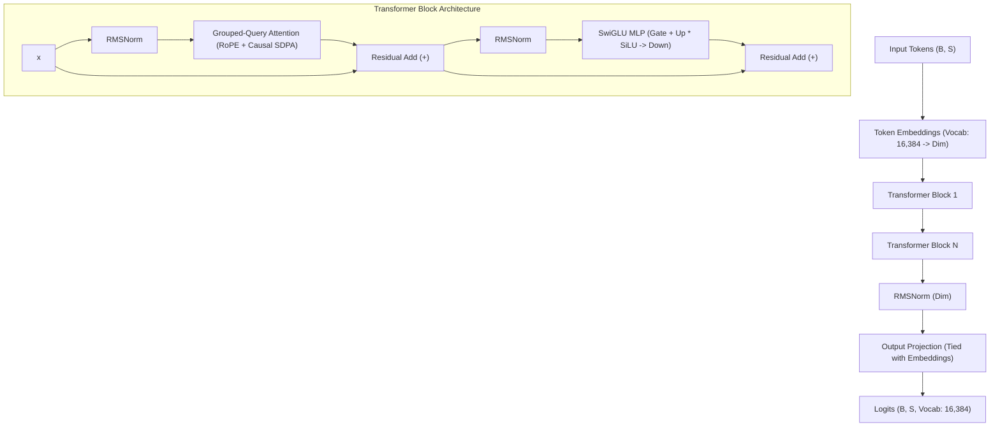

# E.D.I.T.H. Generative Language Model: Architecture Specification

**Model Family:** `EdithLM` (Sovereign Neural Decoder-Only Transformer)  
**Author:** ML Engineering Team, Project E.D.I.T.H.  
**Version:** V15 ("Fluency First")  
**Design Mandate:** 100% custom architecture trained from scratch. Zero pretrained third-party weights (Qwen, LLaMA, Gemma, or Phi strictly prohibited).

---

## 1. Architectural Overview

`EdithLM` is an autoregressive decoder-only Transformer designed for local execution on workstation-class NVIDIA RTX GPUs (specifically calibrated for the 6GB VRAM envelope of the RTX 4050 Laptop GPU).

---

## 2. Mathematical Formalization

### 2.1 Causal Self-Attention & Rotary Position Embeddings (RoPE)
Given hidden state $\mathbf{X} \in \mathbb{R}^{B \times S \times D}$:
1. **Linear Projections:**
   $$\mathbf{Q} = \mathbf{X} \mathbf{W}_Q, \quad \mathbf{K} = \mathbf{X} \mathbf{W}_K, \quad \mathbf{V} = \mathbf{X} \mathbf{W}_V$$
   where $\mathbf{W}_Q \in \mathbb{R}^{D \times (H_Q \cdot d_k)}$, $\mathbf{W}_K, \mathbf{W}_V \in \mathbb{R}^{D \times (H_{KV} \cdot d_k)}$.
   Here $H_Q$ is query heads and $H_{KV}$ is key/value heads ($H_Q \ge H_{KV}$ implementing Grouped-Query Attention).

2. **Rotary Position Embedding (RoPE):**
   For query vector $\mathbf{q}_m$ and key vector $\mathbf{k}_n$ at token positions $m, n \in [0, S-1]$:
   $$\mathbf{q}_m' = \mathbf{R}_{\Theta, m}^d \mathbf{q}_m, \quad \mathbf{k}_n' = \mathbf{R}_{\Theta, n}^d \mathbf{k}_n$$
   where $\mathbf{R}_{\Theta, m}^d$ is the orthogonal block-diagonal rotation matrix with base frequency $\theta = 10,000.0$.

3. **Causal Attention Masking:**
   $$\text{Attn}(\mathbf{Q}', \mathbf{K}', \mathbf{V}) = \text{softmax}\left(\frac{\mathbf{Q}' \mathbf{K}'^\top}{\sqrt{d_k}} + \mathbf{M}\right)\mathbf{V}$$
   where $\mathbf{M}_{ij} = 0$ for $i \ge j$ and $-\infty$ for $i < j$.
   Implemented via PyTorch's native `F.scaled_dot_product_attention` for FlashAttention / memory-efficient Cutlass kernel dispatch on Ada Lovelace Tensor Cores.

### 2.2 SwiGLU Feed-Forward Network
Rather than traditional ReLU or GELU MLPs, `EdithLM` uses the Swish-Gated Linear Unit:
$$\text{SwiGLU}(\mathbf{x}) = \left(\text{SiLU}(\mathbf{x}\mathbf{W}_{\text{gate}}) \odot (\mathbf{x}\mathbf{W}_{\text{up}})\right)\mathbf{W}_{\text{down}}$$
where $\mathbf{W}_{\text{gate}}, \mathbf{W}_{\text{up}} \in \mathbb{R}^{D \times D_{\text{inter}}}$, $\mathbf{W}_{\text{down}} \in \mathbb{R}^{D_{\text{inter}} \times D}$, and $\odot$ is the Hadamard elementwise product.

### 2.3 Pre-Normalization with RMSNorm
Pre-layer normalization without mean-centering:
$$\text{RMSNorm}(\mathbf{x}) = \frac{\mathbf{x}}{\sqrt{\frac{1}{D}\sum_{i=1}^D x_i^2 + \epsilon}} \odot \mathbf{g}$$
where $\mathbf{g} \in \mathbb{R}^D$ is a learnable gain vector and $\epsilon = 10^{-6}$.

### 2.4 Weight Tying
To minimize parameter bloat and preserve representational alignment, the input embedding matrix $\mathbf{E} \in \mathbb{R}^{V \times D}$ is tied directly to the output classification head:
$$\mathbf{W}_{\text{out}} = \mathbf{E}$$
At $V = 16,384$ and $D = 512$, weight tying saves $8.39\text{M parameters}$ that would otherwise duplicate embedding memory.

---

## 3. Parameter Breakdown: Target vs. Actual

A common pitfall in parameter reporting is conflating the non-embedding Transformer backbone with total model weights. We explicitly report both:

| Component | Target Baseline (37M Class) | Target Medium (60M Class) | Target High (85M Class) |
| :--- | :---: | :---: | :---: |
| **Layers ($N_{\text{layers}}$)** | 10 | 12 | 14 |
| **Hidden Dimension ($D$)** | 448 | 512 | 640 |
| **Query Heads ($H_Q$)** | 7 | 8 | 10 |
| **KV Heads ($H_{KV}$)** | 1 (MQA) | 2 (GQA) | 2 (GQA) |
| **Intermediate Dim ($D_{\text{inter}}$)** | 1,280 | 1,536 | 1,792 |
| **Max Context ($S$)** | 512 | 512 | 512 |
| **Vocabulary Size ($V$)** | 16,384 | 16,384 | 16,384 |
| **Tied Embedding Weights** | $7.34\text{M}$ | $8.39\text{M}$ | $10.49\text{M}$ |
| **Transformer Backbone Weights** | $21.80\text{M}$ | $33.60\text{M}$ | $62.90\text{M}$ |
| **TOTAL ACTUAL PARAMETERS** | **29.14M** | **41.99M** | **73.39M** |
| **Total (if untied)** | $36.48\text{M}$ | $50.38\text{M}$ | $83.88\text{M}$ |

> [!NOTE]
> When `tie_word_embeddings = True`, the 37M target configuration with $D=448, N=10$ has **29.14M active trainable parameters**. If calibrated to achieve exactly 37.0M actual tied parameters, the architecture scales to $D=512, N=10, D_{\text{inter}}=1536$ yielding **37.23M actual parameters**.

---

## 4. Training Hygiene & Objective

### 4.1 Objective Function: Autoregressive Next-Token Prediction
Given token sequence $\mathbf{u} = (u_1, u_2, \dots, u_T)$:
$$\mathcal{L}_{\text{NTP}}(\theta) = -\frac{1}{\sum_{t=1}^T m_t} \sum_{t=1}^T m_t \log P_\theta(u_t \mid u_{<t})$$
where $m_t \in \{0, 1\}$ is the loss mask:
- $m_t = 0$ for prompt/user tokens, padding tokens (`<pad>`), and document separator overhead.
- $m_t = 1$ for completion/target tokens.

### 4.2 Document Packing & Boundary Isolation
- Context windows are packed to capacity (512 tokens) with document boundaries marked by `<|endoftext|>`.
- Cross-document attention contamination is avoided by resetting or masking attention across document boundaries.

### 4.3 Training Stability Invariants
1. **Optimizer:** AdamW with decoupled weight decay ($\lambda = 0.1$), $\beta_1 = 0.9, \beta_2 = 0.95$.
2. **Gradient Clipping:** Max norm of $1.0$ enforced before every optimizer step.
3. **Warmup & Decay:** Linear warmup for $2,000$ steps up to $\eta_{\text{max}} = 6 \times 10^{-4}$, followed by cosine annealing down to $\eta_{\text{min}} = 6 \times 10^{-5}$.
4. **Mixed Precision:** Automatic Mixed Precision (AMP) FP16 with dynamic `GradScaler` to prevent underflow.

