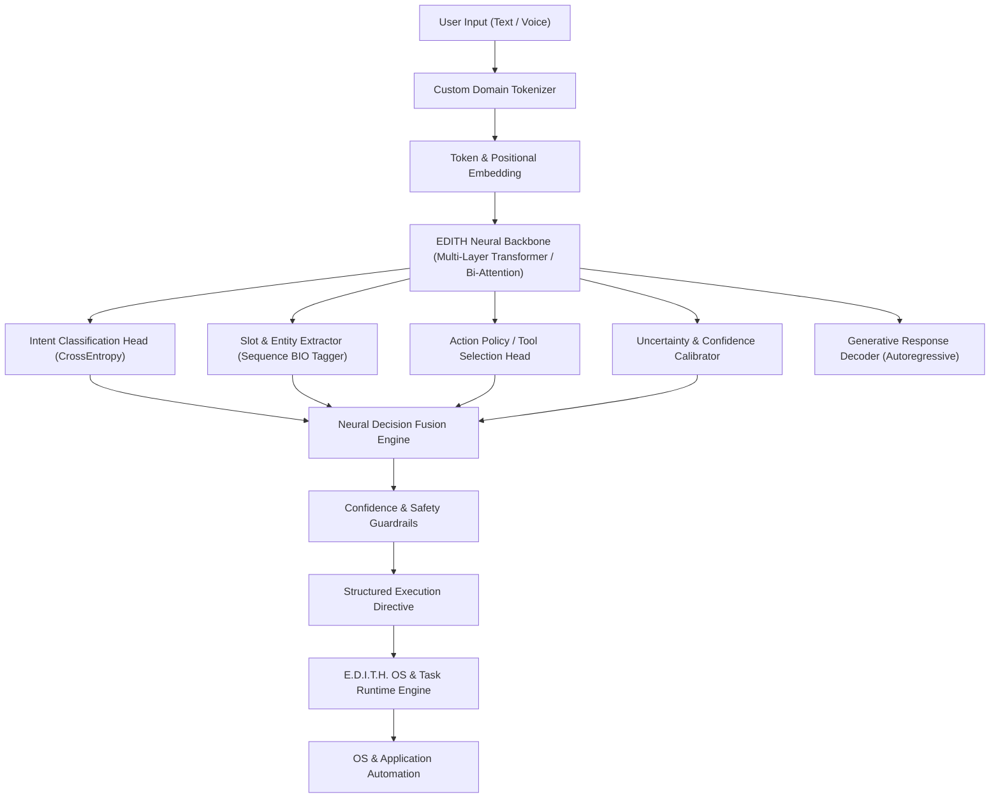

# E.D.I.T.H. — Architecture & Neural Network Specification
**Enhanced Digital Intelligence & Task Handler**

---

## 1. Vision & Core Philosophy

E.D.I.T.H. is built from first principles as an autonomous, neural-network-driven digital assistant and task execution engine. 

### Non-Negotiable Principle
**No Third-Party Wrapper APIs**: EDITH does not rely on calling OpenAI, Anthropic, Gemini, Qwen, or Llama cloud endpoints. The intelligence core is a custom-designed Artificial Neural Network (ANN) trained on tailored domain datasets for command understanding, contextual slot-filling, intent classification, policy decision-making, and software task automation.

---

## 2. System Architecture Overview



---

## 3. Neural Network Design (EDITH-ANN)

### 3.1 Tokenization Layer (`edith_ann/tokenizer.py`)
- Custom subword/vocabulary tokenizer designed specifically for system control and natural task language.
- Special tokens: `<PAD>`, `<UNK>`, `<BOS>`, `<EOS>`, `<INTENT>`, `<SLOT>`, `<ACTION>`, `<PARAM>`.
- Preserves file paths, system variables, URLs, application names, and command parameters.

### 3.2 Encoder Backbone (`edith_ann/model.py`)
- **Embedding Dim ($d_{model}$)**: 256 (scalable to 512 / 768)
- **Attention Heads ($n_{heads}$)**: 8
- **Encoder Layers ($N$)**: 6 Transformer encoder blocks with Pre-LayerNorm, Multi-Head Self-Attention, and GELU Feed-Forward Networks ($d_{ff} = 1024$).
- **Positional Encoding**: Learnable sinusoidal/dense positional embeddings supporting arbitrary context lengths up to 256 tokens.

### 3.3 Multi-Task Cognitive Heads
1. **Intent Classification Head**:
   - Global pooled representation $\to$ LayerNorm $\to$ Dense $\to$ Softmax over discrete intents (e.g., `system_control`, `app_launch`, `file_op`, `web_task`, `process_kill`, `workflow_auto`).
2. **Entity & Slot Tagging Head**:
   - Token-level representation $\to$ Dropout $\to$ Linear $\to$ Logits over BIO labels (`B-APP`, `I-APP`, `B-FILE`, `I-FILE`, `B-TARGET`, `I-TARGET`, etc.).
3. **Action Policy Head**:
   - Maps intent representations into executable tool/action identifiers with parameter expectations.
4. **Calibrated Confidence Scorer**:
   - Measures out-of-distribution (OOD) novelty to prevent hallucinations on ambiguous or unknown commands.
5. **Autoregressive Response Head**:
   - Generates natural language feedback and acknowledgment sentences.

---

## 4. Multi-Task Training Objective

$$\mathcal{L}_{total} = \lambda_1 \mathcal{L}_{intent} + \lambda_2 \mathcal{L}_{slot} + \lambda_3 \mathcal{L}_{policy} + \lambda_4 \mathcal{L}_{gen}$$

- $\mathcal{L}_{intent}$: Categorical Cross-Entropy for intent classification.
- $\mathcal{L}_{slot}$: Masked Token-level Cross-Entropy over non-padding tokens.
- $\mathcal{L}_{policy}$: Focal Loss / Cross-Entropy for tool and action dispatch.
- $\mathcal{L}_{gen}$: Causal Language Modeling loss for task feedback responses.

---

## 5. Directory Structure

```
E.D.I.T.H/
├── config/
│   └── model_config.json          # Architecture and training hyperparameters
├── data/
│   ├── dataset_generator.py       # High-diversity dataset generator for EDITH commands
│   ├── train_data.json            # Generated training dataset
│   └── val_data.json              # Validation dataset
├── edith_ann/
│   ├── __init__.py
│   ├── tokenizer.py               # Custom vocab and tokenization engine
│   ├── modules.py                 # Multi-Head Attention, FeedForward, Positional Encoding
│   ├── model.py                   # Multi-Task EDITH-ANN Architecture
│   └── loss.py                    # Multi-Task Loss Functions
├── engine/
│   ├── __init__.py
│   ├── inference.py               # Optimized inference engine
│   └── edith_brain.py             # High-level cognitive brain interface
├── runtime/
│   ├── __init__.py
│   └── executor.py                # OS and application task handler
├── scripts/
│   ├── setup_edith_model.bat      # Python/environment setup script
│   └── run_training.bat           # One-click training execution script
├── docs/
│   └── architecture.md            # Architecture specification document
├── train.py                       # Training loop with metrics and checkpointing
├── evaluate.py                    # Test suite and model evaluation benchmark
└── requirements.txt               # Core dependencies (PyTorch, NumPy, etc.)
```
